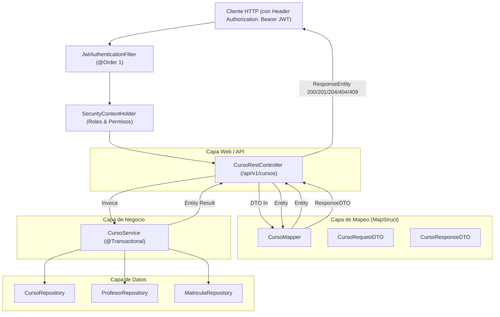

# 02. Plan Técnico de Implementación (`02-plan.md`) — 001-cursos-rest-api: API REST de Cursos con JWT

> **Regla de Oro de Spec-Kit:** Este documento traduce los requerimientos de `01-spec.md` en el **CÓMO** técnico arquitectónico, respetando el 100% de las cláusulas de `specs/00-constitution.md`. **No se escribe código de producción en esta fase.**

---

## 1. Auditoría y Análisis de Componentes Existentes (Reutilización vs. Construcción)

Para garantizar la no duplicación y el respeto a la base de código existente en `com.compunet.springboot`:

| Componente | Paquete | Estado | Acción Técnica |
| :--- | :--- | :---: | :--- |
| `Curso.java` | `model` | **Existente** | Reutilizar sin alteraciones de esquema. Posee relación `@ManyToOne` con `Profesor` y `@OneToMany` con `Matricula`. |
| `Profesor.java` | `model` | **Existente** | Reutilizar sin alteraciones para validaciones de existencia e integridad. |
| `Matricula.java` | `model` | **Existente** | Reutilizar para validación de restricciones de borrado de cursos. |
| `CursoRepository.java` | `repository` | **Existente (Extender)** | Añadir métodos derivados: `findByDepartamentoIgnoreCase(String departamento)` y `findByProfesorId(Long profesorId)`. |
| `ProfesorRepository.java`| `repository` | **Existente** | Reutilizar `existsById(Long id)` y `findById(Long id)`. |
| `MatriculaRepository.java`| `repository` | **Existente (Extender)** | Añadir método derivado `boolean existsByIdCursoId(Long cursoId)` para validar si el curso tiene estudiantes antes de eliminar. |
| `CursoService.java` | `service` | **Existente (Extender)** | Reutilizar `listarTodos()`, `obtenerPorId()`, `registrarCurso()`, `actualizarCurso()`. Extender con `listarPorDepartamento()`, `listarPorProfesorId()` y blindar `eliminarCurso()` contra violaciones de integridad (`409 Conflict`). |
| `CursoRequestDTO.java` | `dtos.Cursos` | **Nuevo** | Crear DTO de entrada con campos obligatorios para payload JSON. |
| `CursoResponseDTO.java`| `dtos.Cursos` | **Nuevo** | Crear DTO de salida aplanado (flattening) con datos de curso y docente sin ciclos ni datos sensibles. |
| `CursoMapper.java` | `mappers` | **Nuevo** | Crear interfaz MapStruct (`componentModel = "spring"`) para transformación bidireccional limpia en tiempo de compilación. |
| `CursoRestController.java`| `controller.api`| **Nuevo** | Crear controlador REST bajo `/api/v1/cursos` asegurado con JWT y `@PreAuthorize`. |

---

## 2. Arquitectura de Capas y Flujo de Ejecución



---

## 3. Diseño de Contratos de Datos (DTOs)

### 3.1. DTO de Entrada: `com.compunet.springboot.dtos.Cursos.CursoRequestDTO`
- **Anotaciones:** `@Data`, `@Builder`, `@NoArgsConstructor`, `@AllArgsConstructor`.
- **Estructura:**
  ```java
  package com.compunet.springboot.dtos.Cursos;

  import lombok.AllArgsConstructor;
  import lombok.Builder;
  import lombok.Data;
  import lombok.NoArgsConstructor;

  @Data
  @Builder
  @NoArgsConstructor
  @AllArgsConstructor
  public class CursoRequestDTO {
      private String nombre;
      private Integer creditos;
      private String departamento;
      private Long profesorId;
  }
  ```
- **Validación de Integridad:** Se valida a nivel de servicio/controlador que `nombre` no sea blanco/nulo, `creditos` sea mayor a 0, `departamento` no sea blanco y `profesorId` no sea nulo.

### 3.2. DTO de Salida: `com.compunet.springboot.dtos.Cursos.CursoResponseDTO`
- **Anotaciones:** `@Data`, `@Builder`, `@NoArgsConstructor`, `@AllArgsConstructor`.
- **Estructura (Aplanamiento / Flattening):**
  ```java
  package com.compunet.springboot.dtos.Cursos;

  import lombok.AllArgsConstructor;
  import lombok.Builder;
  import lombok.Data;
  import lombok.NoArgsConstructor;

  @Data
  @Builder
  @NoArgsConstructor
  @AllArgsConstructor
  public class CursoResponseDTO {
      private Long id;
      private String nombre;
      private int creditos;
      private String departamento;
      private Long profesorId;
      private String profesorNombre;
      private String profesorDepartamento;
  }
  ```

---

## 4. Estrategia de Mapeo con MapStruct (`CursoMapper.java`)

- **Paquete:** `com.compunet.springboot.mappers`
- **Configuración:** `@Mapper(componentModel = "spring")`
- **Definición técnica:**
  ```java
  @Mapper(componentModel = "spring")
  public interface CursoMapper {

      @Mapping(target = "profesorId", source = "profesor.id")
      @Mapping(target = "profesorNombre", source = "profesor.usuario.nombre")
      @Mapping(target = "profesorDepartamento", source = "profesor.departamento")
      CursoResponseDTO toCursoResponseDTO(Curso curso);

      List<CursoResponseDTO> toListCursoResponseDTO(List<Curso> cursos);

      @Mapping(target = "id", ignore = true)
      @Mapping(target = "profesor", ignore = true)
      @Mapping(target = "matriculas", ignore = true)
      Curso toCurso(CursoRequestDTO requestDTO);
  }
  ```
  > [!NOTE]
  > El campo `profesor` se ignora deliberadamente en `toCurso(requestDTO)` porque la asociación relacional administrada por JPA es resuelta por la capa `CursoService` a través de `profesorRepository.findById(profesorId)`.

---

## 5. Modificaciones y Extensiones Requeridas en Repositorios y Servicios

### 5.1. `CursoRepository.java`
Agregar las siguientes firmas derivadas de Spring Data JPA:
```java
List<Curso> findByDepartamentoIgnoreCase(String departamento);
List<Curso> findByProfesorId(Long profesorId);
```

### 5.2. `MatriculaRepository.java`
Agregar firma para verificar matrículas activas:
```java
boolean existsByIdCursoId(Long cursoId);
```

### 5.3. `CursoService.java`
Extender la lógica de negocio:
1. `listarPorDepartamento(String departamento)`:
   - Invoca `cursoRepository.findByDepartamentoIgnoreCase(departamento)`.
2. `listarPorProfesorId(Long profesorId)`:
   - Valida si el profesor existe con `profesorRepository.existsById(profesorId)`. Si no existe, lanza `NoSuchElementException("No se encontró el profesor con ID: " + profesorId)`.
   - Si existe, retorna `cursoRepository.findByProfesorId(profesorId)`.
3. `eliminarCurso(Long id)`:
   - Si `!cursoRepository.existsById(id)`, lanza `NoSuchElementException("No se encontró el curso con ID: " + id)`.
   - Si `matriculaRepository.existsByIdCursoId(id)`, lanza `IllegalStateException("No se puede eliminar el curso porque tiene estudiantes matriculados asociados.")`.
   - En caso favorable, ejecuta `cursoRepository.deleteById(id)`.

---

## 6. Matriz de Endpoints y Seguridad Declarativa (`CursoRestController.java`)

- **Ruta Base:** `@RequestMapping("/api/v1/cursos")`
- **Paquete:** `com.compunet.springboot.controller.api`
- **Inyección:** `private final CursoService cursoService;` y `private final CursoMapper cursoMapper;` mediante `@RequiredArgsConstructor`.

| Método HTTP | Endpoint URI | Regla `@PreAuthorize` | Parámetros / Payload | Respuesta Exitosa | Respuestas de Error Semánticas |
| :--- | :--- | :--- | :--- | :--- | :--- |
| `GET` | `/api/v1/cursos` | `hasAuthority('COURSE_READ')` | `@RequestParam(required = false) String departamento` | `200 OK` (`List<CursoResponseDTO>`) | `401 Unauthorized` (sin JWT)<br>`403 Forbidden` |
| `GET` | `/api/v1/cursos/{id}` | `hasAuthority('COURSE_READ')` | `@PathVariable Long id` | `200 OK` (`CursoResponseDTO`) | `404 Not Found`<br>`401` / `403` |
| `GET` | `/api/v1/cursos/profesor/{profesorId}` | `hasAuthority('COURSE_READ')` | `@PathVariable Long profesorId` | `200 OK` (`List<CursoResponseDTO>`) | `404 Not Found` (si profesor no existe)<br>`401` / `403` |
| `POST` | `/api/v1/cursos` | `hasAuthority('COURSE_WRITE')` | `@RequestBody CursoRequestDTO dto` | `201 Created` + Header `Location` (`CursoResponseDTO`) | `400 Bad Request` (campos inválidos)<br>`404 Not Found` (profesor inexistente) |
| `PUT` | `/api/v1/cursos/{id}` | `hasAuthority('COURSE_WRITE')` | `@PathVariable Long id`<br>`@RequestBody CursoRequestDTO dto` | `200 OK` (`CursoResponseDTO`) | `404 Not Found` (curso o profesor inexistente)<br>`400 Bad Request` |
| `DELETE`| `/api/v1/cursos/{id}` | `hasRole('ADMINISTRADOR')` | `@PathVariable Long id` | `204 No Content` (cuerpo vacío) | `409 Conflict` (si tiene matrículas)<br>`404 Not Found`<br>`403 Forbidden` (si es Profesor) |

---

## 7. Verificación de Cumplimiento Constitucional (`specs/00-constitution.md`)

- [x] **Art. 1 (Stack Inalterable):** Se emplea Java 17, Spring Boot 4.0.8, JJWT 0.12.6 y MapStruct 1.5.5.Final.
- [x] **Art. 2 (Arquitectura en Capas):** Ubicación exacta en `controller.api`, `dtos.Cursos`, `mappers`, `service`, `repository` y `model`.
- [x] **Art. 3 (Aislamiento DTO):** Ningún método del controlador recibe ni retorna `Curso` o `Profesor`. Todo el intercambio es mediante `CursoRequestDTO` y `CursoResponseDTO`.
- [x] **Art. 3 (Inyección por Constructor):** Prohibido `@Autowired` de campo. Se utiliza `private final` y `@RequiredArgsConstructor`.
- [x] **Art. 3 (Semántica REST):** Rutas en plural `/api/v1/cursos`, código `201 Created` con encabezado `Location`, `204 No Content` en DELETE y `409 Conflict` en restricciones referenciales.
- [x] **Art. 4 (Seguridad RBAC):** Autorizaciones estrictas con `@PreAuthorize("hasAuthority('COURSE_READ')")`, `@PreAuthorize("hasAuthority('COURSE_WRITE')")` y exclusividad de borrado para `@PreAuthorize("hasRole('ADMINISTRADOR')")`.
- [x] **Art. 5 (Verificación Continua):** Validable mediante compilación limpia `./mvnw test-compile`.
